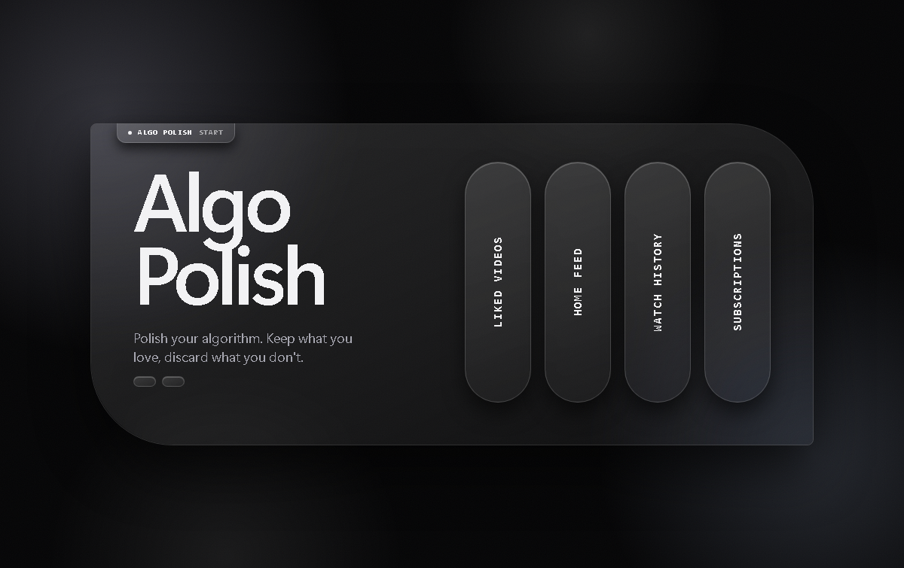

<<<<<<< HEAD
# Algo Polish

Polish your algorithm. Swipe through your YouTube **liked videos**, **watch history**, **home feed** or **subscriptions**, keep what you love, and pick what to remove. Cleaner history means cleaner recommendations.

<p align="center"></p>

Algo Polish is a browser extension (Chrome, Brave, Edge). It runs inside the YouTube tab you already have open, so there is no login, no API key, and nothing to trust with your credentials. Part of the [pmq-z portfolio](https://github.com/pmq-z).

## Features

- **Swipe review:** one video at a time, thumbnail and title in the middle. Drag the card or use the buttons.
- **Keep or discard:** discarded videos go to a queue; kept videos are remembered and skipped next time.
- **Swipe motion:** the card leans into your drag with a stamp that fades in (Discard, Keep, Unsubscribe), the queue lights up once you are past halfway, and a released card shrinks into the queue while the next one springs up. The queue and instructions sit on the left, so a left swipe slides toward the queue and a right swipe toward the kept counter. The next card waits slightly behind the current one and grows forward as you drag, so a swipe flows into the next video instead of cutting. People who prefer reduced motion in their system settings get instant swaps instead.
- **Drag back from the queue:** changed your mind? Drag a queued row onto the card to review it again (before its removal has started). Dropping elsewhere sends it back to the queue.
- **Look:** a frosted-glass dossier-and-HUD style in a warm-black, cream and signal-red palette (red only where you act): glass tab headers, a progress dial, stacked queue sheets, and a position readout on the card, mono labels, and a paper-grey light mode or black dark mode.
- **Background loading:** choosing a source opens it in a background tab (it never takes focus) and starts scanning right away. If YouTube refuses to load more rows while the tab is hidden, the tab comes forward briefly to finish and focus returns to the app. Closing that YouTube tab is fine once you are done.
- **Channel cards:** in the Subscriptions audit each card shows the channel's picture and name plus up to three videos you watched or liked from it. The refresh button turns to the next three. These come from your last Watch history and Liked scans, so scan those once to fill them in.
- **Tag reload:** when there are more tags than fit, the refresh button next to the chips shows the next set and wraps around.
- **Hands off your other tabs:** the page scripts act only on the list they were asked about. If the tab you scanned has since moved on (to a video, say), nothing is scrolled or clicked there, and removals continue in a separate background tab.
- **No misclicks:** nothing on the card opens the video.
- **Undo:** a 2 second window before any removal starts, plus an undo for your last decisions.
- **Paced queue:** removals happen one at a time with short, slightly random pauses. Pause or retry anytime.
- **Topic chips:** repeated channels and keywords in your titles become chips above the card (5+ videos each). Click one to review it first, keep it all, or discard it all.
- **Rules:** auto-queue videos by channel, title keyword, Shorts, "barely watched" (under N% watched) or age (history only). A preview shows how many each rule matches before anything is queued.
- **Protected channels:** never touched by rules or bulk actions. Protect with the shield on the card, from a chip, or in the rules dialog.
- **Backup:** a JSON list of everything scanned, saved on demand with **Backup** or when you choose it in the bulk-removal popup. The file has an `About` block that explains what it is and what you can do with it (find a video again, re-subscribe, sort it in a spreadsheet). It cannot be imported back.
- **Key and button animation:** the arrow keys and the Keep/Discard buttons lean the card toward its verdict (tilt, stamp, button press) before it flies off, like a drag does. Fast repeats skip the lean, and reduced-motion settings disable it.
- **Format filter:** All / Long / Shorts buttons above the tags show only that format. With Shorts or Long chosen, an extra tag ("Every Short") holds everything in view, so a Shorts purge is two taps plus the confirmation popup. Videos outside the filter are never touched; they wait until you switch back.
- **Complete scans:** a scan runs to the end of the list: it waits for YouTube's "loading more" spinner to disappear (up to 25 quiet seconds), and pauses if you switch away from the YouTube tab instead of giving up. A background tab cannot be trusted to load a long list, so anything beyond a short list is finished in a visible tab (the tab is brought forward, then focus returns). If a scan still stops early, the note under the queue says "may be incomplete" and Rescan carries on.
- **How Shorts are recognised:** a `/shorts/` link (History and Home list Shorts this way, so they are now scraped as videos), a Shorts shelf, a "Shorts" label or overlay on the thumbnail, a `#shorts` title, a tall thumbnail, or a link to the same video elsewhere on the page. Shorts seen in one list are remembered for the others. Duration is read but deliberately not used on its own, because Shorts can run up to three minutes and many ordinary clips are that short. After a scan, the note under the queue says how many Shorts were found and by which signal.
- **Setups (presets):** in **Rules**, tap a setup (built-in ones: Shorts purge, Barely watched, Old and forgotten) to load its rules and format, then check the preview and apply. **Save setup** stores your own. Loading a setup replaces the current rules, but unsaved ones are parked as "Previous rules" first.
- **Export / import settings:** **Rules** has Export settings and Import settings. The file holds rules, protected channels and setups. Import checks every entry, ignores invalid ones, and merges by default (tick the box to replace instead).
- **Clear searches:** on the Watch history screen, removes the recent searches YouTube offers under its search box, one by one, after a confirmation. The YouTube tab is brought forward briefly for this. It depends on YouTube's page layout, so if it finds nothing, YouTube may have changed it.
- **One working tab:** the tool opens at most one background tab and sends it to whichever list you pick, instead of opening a new tab per source.
- **Bulk popup:** bulk removals and unsubscribes use their own two-step popup instead of the browser's: first "are you sure?", then "save a backup first?" with a plain explanation of the file. Escape or Cancel stops everything.
- **Home Trainer:** swipe your Home feed to send YouTube feedback. Left is "Not interested", down (or the slashed-circle icon on the card) is "Don't recommend channel", right keeps. A channel chip can block a whole channel with one request. This steers future recommendations, where removing history only fixes the past.
- **Subscription Audit:** swipe through the channels you subscribe to, least watched first. The card shows the channel's picture, its name and up to three videos you watched or liked from it (Shorts appear as tall tiles), with a button to show three more. Each card shows how many of your scanned history videos came from that channel and when you last watched it, so scan **Watch history** first (the counts are saved on your device and reused). Three tags group the obvious candidates: never watched, quiet for 6+ months, and 1 to 2 videos only. Unsubscribing is real and cannot be undone by this tool, so it is slower than removing videos (about 2 seconds apart, with a longer pause every fifth), a bulk unsubscribe is limited to 25 channels at a time and asks for confirmation, and a backup list of your subscriptions (with links to subscribe again) is saved before the first one. Protected channels never appear in the audit, and Rules do not apply to it. Before it clicks anything, the page script reads the Subscribe button to make sure you are subscribed; if it cannot tell (an unrecognised page language) it clicks nothing and reports an error.
- **Dark mode:** a black page with grey panels and white text (the default). Switch to light with the toggle on the first screen or in the side panel. Your choice is remembered.
- **Survives reloads:** unfinished removals are saved and resume the next time you open the app and pick the same source.
- **Loads everything:** auto-scrolls to the end of the list, so long histories are not cut off.

| Key | Action |
| --- | --- |
| `←` | Discard |
| `→` | Keep |
| `Z` | Undo |

## Install

1. Download or clone this repository.
2. Open `chrome://extensions` (or `brave://extensions`, `edge://extensions`).
3. Turn on **Developer mode** and click **Load unpacked**.
4. Select the project folder.

## Use

1. Open YouTube, signed in, on your **Liked videos** (`youtube.com/playlist?list=LL`), **Watch history** (`youtube.com/feed/history`), **Home** (`youtube.com`) or **Subscriptions** channel list (`youtube.com/feed/channels`) page.
2. Click the Algo Polish icon and choose a source.
3. Wait while it scrolls the list (it briefly switches to the YouTube tab, then back).
4. Swipe. Discarded videos are removed from YouTube by the queue.

Keep the YouTube tab open until the queue is empty. If you close everything early, the rest of the queue is saved and continues next time.

## How it works

The app page talks to a small script injected into your YouTube tab. That script reads the video links on the page and, for a discard, clicks the same buttons you would (the three-dot menu, then "Remove"). No private APIs are used.

## Limitations

- YouTube changes its layout often. If scanning or removal breaks, open an issue with the debug text shown, or see "When YouTube changes its layout" below.
- Removal is matched by the word "remove" in about a dozen languages.
- Shorts in watch history are skipped, because they use a different page layout. The Shorts rule only sees Shorts that appear as normal video links.
- "Barely watched" reads the progress bar on the page. Videos without a bar are never matched.
- "Older than" works on watch history only, since the Liked list shows no dates. It reads English date headers, and videos with an unreadable header are skipped.
- Home scans stop at 60 videos, because the feed never ends. Rescan for more. Home queues are not saved between sessions, since the feed changes every visit.
- "Not interested" and "Don't recommend channel" are found by their menu text (English plus a few languages). If a language is missing, the queue row shows an error. Tell me your YouTube language.
- The Home layout changes often, so channel names may be empty on some tiles. Channel chips and "Don't recommend channel" for a group need the name.
- Tags are word counts, not understanding. They are noisy for non-English titles. A tag needs at least 5 videos and 1.5% of the deck, and at most 5 channel tags and 6 keyword tags are shown.
- Right after a removal, only Watch history can confirm the video left the page. Liked and Home are checked on the next Rescan, which reloads the YouTube tab and retries anything that is still listed once.
- Saved removals resume after the next scan. Any that YouTube no longer lists are counted as already removed, so an incomplete scan can skip some; they simply come back for review.
- Removed items cannot be restored by this tool, and neither can an unsubscribe. The subscription backup lists the links so you can subscribe again by hand.
- The Subscriptions audit reads the `youtube.com/feed/channels` list. Counts come from the Liked and History scans you ran earlier, which may not cover your whole history, so "never watched" means "not in the videos that were scanned". Matching uses the channel link, then the channel name.
- Unsubscribing needs the Subscribe button's state to be readable (English plus a few languages). In another language the audit reports an error instead of clicking.

## When YouTube changes its layout

Every selector and menu word the page scripts use is in `js/scrapers/Where_The_Streets_Have_No_Name.js`, inside one object called `Treasure_Map`. Lists such as `Menu_Button` are tried in order, so add the new guess as the first entry and keep the old ones as backups. No other file needs to change.

## Project layout

Files are named after songs and quotes that match their role. Folders group them by job.

```
algo-polish/
├── manifest.json
├── README.md  LICENSE  PRIVACY.md  DISCLAIMER.md
├── icons/        toolbar and tab icons
├── tools/        the icon generator
├── styles/       Fashion.css
├── pages/        Welcome_To_The_Jungle.html
└── js/
    ├── background/   the service worker
    ├── core/         state, logic, queue, rules, messaging, entry point
    ├── ui/           rendering, swipe motion, tags, theme
    └── scrapers/     scripts injected into the YouTube tab
```

| File | Role |
| --- | --- |
| `js/background/Open_Sesame.js` | Background: opens the app tab |
| `pages/Welcome_To_The_Jungle.html` | App page |
| `styles/Fashion.css` | Styling |
| `js/core/Lets_Get_It_Started.js` | Main: wires up the page |
| `js/core/The_Notebook.js` | Shared state and settings |
| `js/core/Should_I_Stay_Or_Should_I_Go.js` | Logic: keep, discard, undo, backup |
| `js/ui/Are_You_Sure.js` | The two-step bulk popup |
| `js/core/Another_One_Bites_The_Dust.js` | Removal queue and pacing |
| `js/core/Rule_The_World.js` | Rules, protected channels, date parsing |
| `js/core/Dont_You_Forget_About_Me.js` | Subscription audit: watch counts per channel, order and tags |
| `js/core/Message_In_A_Bottle.js` | Talks to the YouTube tab |
| `js/core/Tik_Tok.js` | Timer worker |
| `js/ui/Paint_It_Black.js` | Rendering |
| `js/ui/Shake_It_Off.js` | Movement: drag, swipe flight, spring-in, undo |
| `js/ui/Birds_Of_A_Feather.js` | Topic groups (tags) |
| `js/ui/Day_Tripper.js` | Applies the saved theme before the page paints |
| `js/scrapers/Where_The_Streets_Have_No_Name.js` | Page script: every selector and menu word in one map |
| `js/scrapers/Elementary_My_Dear_Watson.js` | Page script: reads the video and channel lists |
| `js/scrapers/Walk_This_Way.js` | Page script: scrolling, removing, unsubscribing |
| `js/scrapers/Hello_Is_It_Me.js` | Page script: answers the app |
| `icons/Pictures_Of_You_*.png` | Toolbar and tab icons |
| `tools/Pictures_Of_You.py` | Draws the icons (`pip install pillow`, then run it) |

Settings such as the undo window, removal pace and minimum group size are at the top of `js/core/The_Notebook.js`.

## Legal

- [Privacy](PRIVACY.md)
- [Disclaimer](DISCLAIMER.md)
- [License](LICENSE) (MIT)
=======
# algo-polish
From time to time,  I like to clean old liked videos, watch history, etc. to better refine the algorithm to me. This project was born to streamline that process in a more eye-catching and less tedious way.
>>>>>>> 558412eac4d28203d27ff8ed85dc483edd43f882
